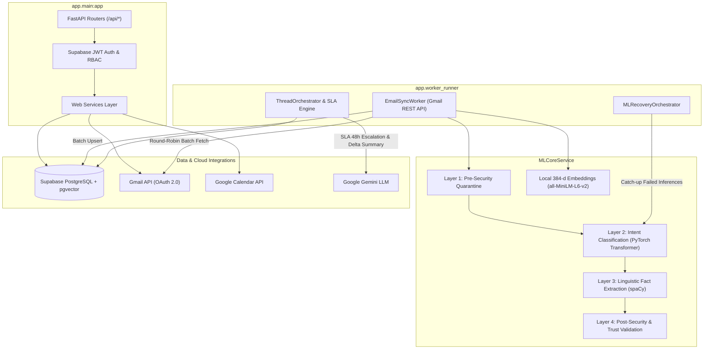

# ⚙️ InboxOrchestrator AI — Backend Core & Worker Engine

> High-performance Python backend powering autonomous multi-account email ingestion, a 4-layer local ML/NLP pipeline, deterministic task structuring, Google Gemini LLM orchestration, and `pgvector` semantic search.

---

## 🏛️ System Architecture & Process Model

The backend runs as a **decoupled dual-process architecture** to separate user-facing REST transactions from heavy, long-running asynchronous email ingestion and ML inference workloads.



---

## 🔄 Core Ingestion & Background Worker Cycles

The Worker Runner Daemon (`app/worker_runner.py`) coordinates continuous, non-blocking background cycles across 4 specialized pipelines:

1. **Onboarding Backfill (`EmailSyncWorker.run_onboarding_cycle`)**:
   * Uses round-robin scheduling (max 2 batches per account per tick) to pull historical messages for newly connected mailboxes without starving active accounts.
2. **Delta Ingestion (`EmailSyncWorker.run_sync_cycle`)**:
   * Synchronizes incoming messages using persistent Gmail history cursors (`historyId`), fetching only new message deltas.
3. **Self-Healing Catch-up (`MLRecoveryOrchestrator.run_recovery_cycle`)**:
   * Scans for emails that bypassed or failed ML analysis (e.g. during rapid onboarding) and executes batch catch-up inference.
4. **Thread Orchestration & SLA Automation (`ThreadOrchestrator.run_cycle`)**:
   * Executes automated 48-hour SLA escalations and evaluates un-orchestrated threads in batches of 50.

---

## 🧠 4-Layer Columnar ML & NLP Pipeline (`MLCoreService`)

Before emails touch any external cloud API, raw messages pass through an inline, local 4-stage pipeline:

```text
Raw Inbound Email Batch
       │
       ▼
┌──────────────────────────────────────────────────────────┐
│ Layer 1: Pre-Security Evaluation (Context-Free)          │
│ • Detects phishing patterns, script payloads & spoofing  │
│ • Safe nodes advance; unsafe chunks are quarantined      │
└──────────────────────────┬───────────────────────────────┘
                           │ (Safe Chunks)
                           ▼
┌──────────────────────────────────────────────────────────┐
│ Layer 2: Intent Classification                           │
│ • Fine-tuned PyTorch Transformer (best-fold checkpoint)  │
│ • Gmail heuristic shortcuts & automated noise filters    │
│ • Categorizes into Focused vs. System/Noise              │
└──────────────────────────┬───────────────────────────────┘
                           │
                           ▼
┌──────────────────────────────────────────────────────────┐
│ Layer 3: Linguistic Fact Extraction (spaCy)              │
│ • Dependency tree parsing & POS tagging                  │
│ • Extracts actionable facts: tasks, commitments,         │
│   questions, and temporal anchor/due dates               │
└──────────────────────────┬───────────────────────────────┘
                           │
                           ▼
┌──────────────────────────────────────────────────────────┐
│ Layer 4: Post-Security & Trust Validation                │
│ • Analyzes SPF/DKIM verification headers                 │
│ • Correlates sender frequency against historical noise   │
└──────────────────────────┬───────────────────────────────┘
                           │
                           ▼
┌──────────────────────────────────────────────────────────┐
│ Vector Embedding Generation                              │
│ • sentence-transformers/all-MiniLM-L6-v2 (384 dims)      │
│ • Synchronously embedded and saved into emails.embedding │
└──────────────────────────────────────────────────────────┘
```

---

## 💡 Token Economy & LLM Orchestration (`ThreadOrchestrator`)

To deliver sub-second triaging and avoid runaway cloud LLM bills, generative AI is applied strictly where human-level synthesis is required:

* **Rule-Based LLM Bypass (~70–80% Cost Reduction)**:
  * When incoming messages introduce no new actionable facts (e.g., standard receipts or automated confirmations), the rules engine derives thread status deterministically and **bypasses Gemini API calls entirely**.
* **Delta Summarization**:
  * Instead of re-sending full conversation histories on every message, the prompt engine compresses history into:
    $$\text{Payload} = \text{Existing Summary} + \text{New Snippet} + \text{Active Tasks} + \text{New Facts}$$
  * This guarantees constant token consumption regardless of thread length.
* **Content Pre-Compression (`ContentCompressorService`)**:
  * Strips boilerplate CSS/HTML, tracking pixels, forwarded headers, and signatures prior to tokenization.
* **Dual Summary Strategy**:
  * **Background Worker**: Ultra-concise, token-minimized delta summary.
  * **User On-Demand (`POST /api/emails/threads/{id}/summary`)**: Comprehensive hybrid context (full text for the 3 most recent emails + pre-extracted facts for older messages).

---

## 🛡️ Deterministic State Machines & Data Integrity

### 1. SLA-Aware Workflow Lifecycle
Every thread is managed via a deterministic 5-stage state machine:
* `needs_action`: Active pending tasks exist on the thread.
* `awaiting_reply`: User sent an outbound message expecting a reply within 48 hours.
* `follow_up`: Background daemon automatically transitions threads exceeding the 48-hour SLA window without reply:
  ```sql
  UPDATE public.email_threads
  SET workflow_status = 'follow_up'
  WHERE workflow_status = 'awaiting_reply' AND last_message_at <= NOW() - INTERVAL '48 hours';
  ```
* `informational`: Default zero-task state; reference-only communication.
* `archived`: Thread completed or closed; skipped by background workers.

### 2. Action Fingerprint Deduplication
To guarantee idempotency across repeated sync loops, actionable tasks generate a deterministic MD5 fingerprint:
$$\text{action\_fingerprint} = \text{MD5}(\text{thread\_id} + \text{action\_verb} + \text{object\_primitive})$$
Inserted using `ON CONFLICT (user_id, action_fingerprint) DO NOTHING`.

### 3. Single Active Draft Enforcement
Enforces at most **1 active unsent draft** (`status = 'draft'` or `'pending_approval'`) per conversation thread. Creating a new draft on an existing thread upserts the active draft instead of producing orphaned duplicates.

---

## 🗄️ Database & Vector Search Model

The storage layer is built on **Supabase (PostgreSQL with `pgvector`)**:

| Table | Purpose | Index Strategy |
| :--- | :--- | :--- |
| `connected_accounts` | Connected OAuth mailboxes & sync states | `(user_id, is_active)` |
| `email_threads` | Conversation aggregation & context memory | `(connected_account_id, last_message_at DESC)`, `(workflow_status, last_message_at)` |
| `emails` | Individual messages, headers & 384-d vectors | `(thread_id, received_at ASC)`, `UNIQUE (gmail_message_id)` |
| `email_facts` | Extracted NLP linguistic commitments & dates | `(email_id)` |
| `tasks` | Actionable items linked to emails/threads | `(user_id, status, due_date ASC)`, `UNIQUE (user_id, action_fingerprint)` |
| `email_drafts` | Synchronized Gmail reply drafts | `(thread_id, status)` |
| `email_draft_resolutions` | Audit trail linking sent drafts to resolved tasks | `(email_draft_id, task_id)` |

### 3-Tier Dynamic Semantic Search RPC
Natural language vector search queries execute via the `match_emails` PostgreSQL RPC with tiered similarity fallback:
* **Tier 1 (High Precision):** Similarity threshold $\ge 0.65$. If $\ge 3$ matches found, returns immediately.
* **Tier 2 (Moderate Fallback):** Similarity threshold $\ge 0.45$.
* **Tier 3 (Broad Fallback):** Similarity threshold $\ge 0.25$.
Results are deduplicated to return the highest-scoring message per thread alongside associated contact profiles.

---

## 🔌 REST API Routing Matrix

All endpoints require a valid Supabase Bearer JWT passed via `Authorization: Bearer <token>`.

| Domain Router | Base Path | Key Capabilities |
| :--- | :--- | :--- |
| **Auth** | `/api/auth` | User profile (`/me`), Google OAuth connect & callback flow. |
| **Threads** | `/api/emails/threads` | Paginated inbox threads, detail timelines, workflow status patches, manual summary generation, on-demand sync. |
| **Tasks** | `/api/emails/tasks` | Task filtering (`status`, `intent`, `priority`), manual creation, status transitions (`completed`, `dismissed`). |
| **Drafts** | `/api/emails/drafts` | Draft generation, Gmail API sync, task resolution associations, draft dispatch. |
| **Calendar** | `/api/emails/calendar` | 1-click export of actionable tasks to Google Calendar via Google Calendar API. |
| **Search** | `/api/emails/search` | 384-d vector similarity search and aggregated contact discovery. |
| **Analytics** | `/api/analytics` | Workload volume, sender action-vs-noise metrics, intent distributions, and SLA breaches. |
| **Settings** | `/api/settings` | Account sync toggles, summary format preferences, and Gemini model variant selection. |

---

## 🛠️ Local Development & Operations

### 1. Prerequisites
* **Python 3.11+**
* Dedicated virtual environment (`.venv`)
* Access to a Supabase project with `pgvector`
* Google Cloud OAuth Client ID & Secret

### 2. Setup Virtual Environment & Dependencies
```bash
# In InboxOrchestratorAI/
python3 -m venv .venv
source .venv/bin/activate

# Install all worker and ML dependencies (PyTorch, Transformers, spaCy):
pip install -r requirements-worker.txt

# Download the spaCy English model:
python -m spacy download en_core_web_sm
```

### 3. Environment Configuration (`.env`)
Create `.env` in `InboxOrchestratorAI/`:
```env
ENVIRONMENT=development
BACKEND_URL=http://localhost:8000
FRONTEND_URL=http://localhost:3000

# Supabase
SUPABASE_URL=https://<project-ref>.supabase.co
SUPABASE_SECRET_KEY=<service-role-or-secret-key>
SUPABASE_PUB_KEY=<anon-key>
SUPABASE_SERVICE_KEY=<service-role-key>

# Google OAuth 2.0 Credentials
OAUTH_CLIENT_ID=<google-oauth-client-id>
OAUTH_CLIENT_SECRET=<google-oauth-client-secret>
GOOGLE_REDIRECT_URI=http://localhost:8000/api/auth/google/callback

# Google Gemini API Key
GEMINI_API_KEY=<your-gemini-api-key>
```

### 4. Running the Processes via `run.sh`

The included `run.sh` script automatically sets up CPU thread pool caps (`OMP_NUM_THREADS=2`, `MKL_NUM_THREADS=2`) to prevent CPU thrashing during local ML inference:

```bash
# Terminal 1: Launch FastAPI REST Web Server (Uvicorn on port 8000)
./run.sh app

# Terminal 2: Launch Autonomous Background Worker Runner Daemon
./run.sh worker

# Optional: Launch Worker with ML inference disabled (saves memory in low-resource environments)
./run.sh worker --skip-ml
```

### 5. Running Tests
```bash
pytest tests/
```
